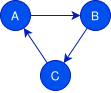



# 標準ライブラリ

## [`Send`] トレイトと [`Sync`] トレイト

[`Send`] トレイトと [`Sync`] トレイト（`std::marker` または `core::marker` で定義）は、
Rust で並行処理の安全性を確保するために使われるマーカートレイトである。正しく
実装されていれば、Rust コンパイラはデータ競合が存在しないことを保証できる。
それぞれの意味論は次のとおりである。

- ある型を別のスレッドへ送る（ムーブする）ことが安全であれば、その型は [`Send`] である。
- ある型への不変参照を別のスレッドと共有することが安全であれば、
  その型は [`Sync`] である。

どちらのトレイトも _unsafe トレイト_ である。すなわち、Rust コンパイラは、それらが
正しく実装されているかどうかを一切検証しない。この危険は現実のものであり、誤った
実装は**未定義動作**につながりうる。

幸い、ほとんどの場合、これらを自分で実装する必要はない。Rust では、
ほぼすべてのプリミティブ型が [`Send`] かつ [`Sync`] であり、大半の複合型については
Rust コンパイラが実装を自動的に提供する。
[Rustonomicon](https://doc.rust-lang.org/stable/nomicon/) で述べられているとおり、主な例外は次のとおりである。

- 生ポインタは、安全のための保護を何も備えていないため、[`Send`] でも [`Sync`] でも
  ない。
- [`UnsafeCell`] は、内部可変性（可変な形で共有される値）を提供するため、[`Sync`] では
  ない（その結果、[`Cell`] と [`RefCell`] も [`Sync`] ではない）。
- [`Rc`] は、参照カウンタが共有され、かつ同期されていないため、[`Send`] でも [`Sync`] でも
  ない。

複合型（構造体または列挙型）では、すべてのフィールドが [`Send`] な型
（または [`Sync`] な型）である場合に、[`Send`]（または [`Sync`]）が自動的に
実装される。

[`Send`] や [`Sync`] が自動的に実装されないようにするには、
  [`PhantomData`] 型の内部フィールドを使えばよい。

```rust
# use std::marker::PhantomData;
#
struct SpecialType(u8, PhantomData<*const ()>);
```

<div markdown="1" class="reco" id="LANG-SYNC-TRAITS" type="Rule" title="`Send` と `Sync` の実装を正当化する">

安全な Rust 開発では、[`Send`] トレイトと [`Sync`] トレイトを手動で実装することは
避けるべきである。必要な場合は、正当化し、文書化
しなければならない。

</div>

## 比較トレイト（[`PartialEq`]、[`Eq`]、[`PartialOrd`]、[`Ord`]）

Rust の比較（`==`、`!=`、`<`、`<=`、`>`、`>=`）は、`std::cmp`
（`no_std` でコンパイルする場合は `core::cmp`）にある四つの標準トレイトに基づいている。

- [`PartialEq<Rhs>`]: `Self` 型のオブジェクトと `Rhs` 型のオブジェクトの間の
  半同値関係を定義する。
- [`PartialOrd<Rhs>`]: `Self` 型のオブジェクトと `Rhs` 型のオブジェクトの間の
  半順序を定義する。
- [`Eq`]: 同じ型のオブジェクトの間の全同値関係を定義する。
  これは `PartialEq<Self>` を要求するだけのマーカートレイトにすぎない。
- [`Ord`]: 同じ型のオブジェクトの間の全順序を定義する。
  `PartialOrd<Self>` が実装されていることを要求する。

標準ライブラリのドキュメントにあるとおり、Rust はこれらのトレイトの各実装について
**多くの不変条件**を前提としている。

- [`PartialEq`] について

  - _内部の一貫性_: `a.ne(b)` は `!a.eq(b)` と等価である。すなわち、`ne` は
    `eq` の厳密な否定である。`ne` の既定の実装は、まさに
    そのとおりになっている。

  - _対称性_: `a.eq(b)` と `b.eq(a)` は等価である。開発者の
    視点では、これは次を意味する。

    - 型 `A` に対して `PartialEq<B>` が実装されている（`A: PartialEq<B>` と書く）。
    - 型 `B` に対して `PartialEq<A>` が実装されている（`B: PartialEq<A>` と書く）。
    - 両方の実装が互いに整合している。

  - _推移性_: `a.eq(b)` かつ `b.eq(c)` ならば `a.eq(c)` である。これは次を意味する。

    - `A: PartialEq<B>`
    - `B: PartialEq<C>`
    - `A: PartialEq<C>`
    - 三つの実装が互いに（また、それぞれの対称な実装とも）
      整合している。

- [`Eq`] について

  - `PartialEq<Self>` が実装されている。

  - _反射性_: `a.eq(a)` が成り立つ。これは `PartialEq<Self>` に対する条件である（[`Eq`] は
    メソッドを一切提供しない）。

- [`PartialOrd`] について

  - _等価性との一貫性_:
    `a.eq(b)` は `a.partial_cmp(b) == Some(std::cmp::Ordering::Equal)` と等価である。

  - _内部の一貫性_:

    - `a.partial_cmp(b) == Some(std::cmp::Ordering::Less)` のとき、かつそのときに限り `a.lt(b)`
    - `a.partial_cmp(b) == Some(std::cmp::Ordering::Greater)` のとき、かつそのときに限り `a.gt(b)`
    - `a.lt(b) || a.eq(b)` のとき、かつそのときに限り `a.le(b)`
    - `a.gt(b) || a.eq(b)` のとき、かつそのときに限り `a.ge(b)`

    なお、`partial_cmp` だけを定義すれば、内部の一貫性は
    `lt`、`le`、`gt`、`ge` の既定の実装によって保証される。

  - _反対称性_: `a.lt(b)`（または `a.gt(b)`）ならば `b.gt(a)`
    （または `b.lt(a)`）である。開発者の視点では、これは次のことも意味する。

    - `A: PartialOrd<B>`
    - `B: PartialOrd<A>`
    - 両方の実装が互いに整合している。

  - _推移性_: `a.lt(b)` かつ `b.lt(c)` ならば `a.lt(c)` である（`gt`、
    `le`、`ge` についても同様）。これは次のことも意味する。

    - `A: PartialOrd<B>`
    - `B: PartialOrd<C>`
    - `A: PartialOrd<C>`
    - これらの実装が互いに（また、それぞれの対称な実装とも）整合している。

- [`Ord`] について

  - `PartialOrd<Self>`

  - _全順序性_: 常に `a.partial_cmp(b) != None` である。言い換えれば、
    `a.eq(b)`、`a.lt(b)`、`a.gt(b)` のうち、ちょうど一つが真である。

  - _`PartialOrd<Self>` との一貫性_: `Some(a.cmp(b)) == a.partial_cmp(b)`。

コンパイラは、型検査そのものを除いて、これらの要件を一切検査しない。
しかし、比較は極めて重要である。スケジューラやロードバランサのように
活性（処理が止まらずに進むこと）が重要なシステムにも、`unsafe` ブロックを
使うことのある最適化されたアルゴリズムにも関わるからである。
前者では、順序付けが誤っていると、デッドロックのような可用性の問題に
つながりうる。
後者では、メモリ安全性の侵害に関連する古典的なセキュリティ問題に
つながりうる。これもまた、`unsafe` ブロックの使用を制限するという実践を
後押しする要因である。

<div markdown="1" class="reco" id="LANG-CMP-INV" type="Rule" title="標準の比較トレイトの不変条件を守る">

安全な Rust 開発では、標準の比較トレイトの実装は、
ドキュメントに記載された不変条件を守らなければならない。

</div>

<div markdown="1" class="reco" id="LANG-CMP-DEFAULTS" type="Recommendation" title="標準の比較トレイトではメソッドの既定の実装を使う">

安全な Rust 開発では、標準の比較トレイトの実装は、
トレイトに結び付いた不変条件を破るリスクを減らすため、既定の実装を持たない
メソッドだけを定義すべきである。

</div>

[`PartialEq`] の実装で `PartialEq::ne` が定義されていないことを検査する
Clippy のリントがある。

Rust には、`#[derive(...)]` 属性によって比較トレイトの実装を自動的に生成する
標準的な方法がある。

- [`PartialEq`] の導出は、各部分型が `PartialEq<Self>` であることを条件に、
  **構造的等価性**による `PartialEq<Self>` を実装する。
- [`Eq`] の導出は、各部分型が [`Eq`] であることを条件に、
  マーカートレイト [`Eq`] を実装する。
- [`PartialOrd`] の導出は、各部分型が [`PartialOrd`] であることを条件に、
  **辞書式順序**による `PartialOrd<Self>` を実装する。
- [`Ord`] の導出は、各部分型が [`Ord`] であることを条件に、
  **辞書式順序**による [`Ord`] を実装する。

例えば、次の短いコードは、二つの `T1` を簡単に比較する方法を示している。
アサーションはすべて成り立つ。

```rust
#[derive(PartialEq, Eq, PartialOrd, Ord)]
struct T1 {
    a: u8, b: u8
}

# fn main() {
assert!(&T1 { a: 0, b: 0 } == Box::new(T1 { a: 0, b: 0 }).as_ref());
assert!(T1 { a: 1, b: 0 } > T1 { a: 0, b: 0 });
assert!(T1 { a: 1, b: 1 } > T1 { a: 1, b: 0 });
# println!("all tests passed.");
# }
```

<div markdown="1" class="warning">

複合型に対する比較トレイトの導出は、フィールドの名前ではなく、
**フィールドの順序**に依存する。

第一に、これは、二つのフィールドの宣言順を入れ替えると、
結果として得られる辞書式順序が変わることを意味する。例えば、次のような二つ目の
順序付き型があるとする。

```rust
#[derive(PartialEq, Eq, PartialOrd, Ord)]
struct T2{
   b: u8, a: u8
};
```

このとき、`T1 {a: 1, b: 0} > T1 {a: 0, b: 1}` であるが、
`T2 {a: 1, b: 0} < T2 {a: 0, b: 1}` となる。

第二に、内部で行われる比較のいずれかがパニックする場合、自動実装では
短絡評価が使われるため、順序によって結果が変わりうる。

列挙型の場合、導出された比較は、まず**バリアントの順序**に、次に
フィールドの順序に依存する。

</div>

順序に関するこの注意点はあるものの、導出による比較は手動で実装した比較よりも
はるかに誤りが起きにくく、コードも短く保守しやすくなる。

<div markdown="1" class="reco" id="LANG-CMP-DERIVE" type="Recommendation" title="可能な限り比較トレイトを導出する">

安全な Rust 開発では、構造的等価性と辞書式比較が必要な場合、
標準の比較トレイトの実装は `#[derive(...)]` で自動的に導出
すべきである。標準の比較トレイトを手動で実装する場合は、
文書化し、正当化すべきである。

</div>

## [`Drop`] トレイト（デストラクタ）

型は、その型の値に対応するメモリが回収されるときに何らかの処理を行うために、
[`std::ops::Drop`] トレイトを実装する。[`Drop`] は、C++ のデストラクタや
Java のファイナライザに相当する Rust の仕組みである。

<div markdown="1" class="note">

このトレイトを実装すると、言語の実行時の意味論が変わる。

</div>

ドロップは、外側の値から内側の値へと再帰的に行われる。
値がスコープを抜けるとき（または [`mem::drop`] で明示的にドロップされるとき）、
その値は二段階でドロップされる。第一段階は、その値の型が [`Drop`] を
実装している場合にのみ行われ、その値に対して [`mem::drop`] メソッドを呼び出す。
第二段階では、その値が含むすべてのフィールドに対して、ドロップの処理を
再帰的に繰り返す。なお、[`Drop`] の実装が
**責任を負うのは外側の値だけ**である点に注意すること。

何よりもまず、[`Drop`] を一律に実装すべきではない。
必要になるのは、その型が何らかのデストラクタ処理を要する場合だけである。実際、[`Drop`] は
典型的には、外部リソース（ネットワーク接続、ファイルなど）の解放や、
メモリの解放（例えば `Box` や [`Rc`] のようなスマートポインタ）に使われる。
その結果、[`Drop`] トレイトの実装には、`unsafe` なコードブロックや、
セキュリティ上重要なその他の操作が含まれやすい。

<div markdown="1" class="reco" id="LANG-DROP" type="Rule" title="`Drop` の実装を正当化する">

安全な Rust 開発では、[`std::ops::Drop`] トレイトの実装は、
正当化し、文書化しなければならない。

</div>

次に、Rust の型システムが保証するのはメモリ安全性だけであり、型システムの
観点では、ドロップが行われないことは許容されている。実際、次のように、
ドロップが行われない原因はいくつもある。

- 参照の循環（例えば [`Rc`] や [`Arc`] によるもの）
- [`mem::forget`] の明示的な呼び出し（
  [`mem::forget` とメモリリーク](unsafe/memory.md#forget-and-memory-leaks)の項を参照）
- ドロップ中のパニック
- プログラムのアボート（および、パニック時にアボートする設定が有効な場合のパニック）

そして、ドロップが行われないと、機密データが露出したり、限りあるリソースが
ロックされたままになって可用性の問題につながったりするおそれがある。

<div markdown="1" class="reco" id="LANG-DROP-NO-PANIC" type="Rule" title="`Drop` の実装でパニックしない">

安全な Rust 開発では、[`std::ops::Drop`] トレイトの実装は
パニックしてはならない。

</div>

パニック以外についても、セキュリティ上重要なドロップは保護すべきである。

<div markdown="1" class="reco" id="LANG-DROP-NO-CYCLE" type="Rule" title="参照カウント方式の `Drop` の循環を許さない">

[`Drop`] を実装する型の値を、参照カウント方式の参照の循環の中に、直接的にも
間接的にも組み込んではならない。
（[循環する参照カウントポインタ](#cyclic-rc-pointer)の節を参照）


</div>

<div markdown="1" class="reco" id="LANG-DROP-SEC" type="Rule" title="セキュリティの確保を `Drop` だけに頼らない">

何らかの処理の終わりに行うセキュリティ上の操作（暗号化処理の終わりに行う
鍵の消去など）を、[`Drop`] トレイトの実装だけに頼って保証しては
ならない。

</div>

## 循環する参照カウントポインタ（[`Rc`] と [`Arc`]） {#cyclic-rc-pointer}

参照カウントポインタを使うと、任意の型の値を複製（クローン）できる。
そのために、これらの値には、その値に結び付いたクローンの数を数えるカウンタが対応付けられ、
カウンタがゼロになると値が破棄される。

この方式では、参照カウントポインタが循環して使われると、メモリリークが生じうる。

<center>



</center>

この例では、オブジェクト `A`、`B`、`C` はそれぞれ、少なくとも一つのほかのオブジェクトから参照されている。これら三つのオブジェクトが存在する限り、
いずれも削除されない。その結果、メモリリークになる。

型定義の中で[内部可変性](https://doc.rust-lang.org/reference/interior-mutability.html)、再帰、参照カウントポインタを**組み合わせる**ことは安全ではない。メモリリークを引き起こす可能性があり、それが DDoS 攻撃や秘密情報の漏えいにつながりうる。

次の例は、安全な Rust でこのようなメモリリークが起きることを示している。

<p class="codetag bad">悪い例</p>

```rust
use std::{cell::Cell, rc::Rc};

struct LinkedStruct {
    other: Cell<Option<Rc<LinkedStruct>>>,
}

fn main() {
    println!("Hello, world!");
    let a = Rc::new(LinkedStruct {
        other: Cell::new(None),
    });
    let b = Rc::new(LinkedStruct {
        other: Cell::new(None),
    });
    let aa = a.clone();
    let bb = b.clone();
    a.other.set(Some(bb));
    b.other.set(Some(aa));
}
```

メモリリークは `valgrind` で確認できる。

```
$ valgrind --leak-check=full target/release/safe-rust-leak 
==153637== Memcheck, a memory error detector
==153637== Copyright (C) 2002-2022, and GNU GPL'd, by Julian Seward et al.
==153637== Using Valgrind-3.19.0 and LibVEX; rerun with -h for copyright info
==153637== Command: target/release/safe-rust-leak
==153637== 
Hello, world!
==153637== 
==153637== HEAP SUMMARY:
==153637==     in use at exit: 48 bytes in 2 blocks
==153637==   total heap usage: 10 allocs, 8 frees, 3,144 bytes allocated
==153637== 
==153637== 48 (24 direct, 24 indirect) bytes in 1 blocks are definitely lost
                in loss record 2 of 2
==153637==    at 0x48417B4: malloc (vg_replace_malloc.c:381)
==153637==    by 0x10F8D4: safe_rust_leak::main
                (in /home/toto/src/safe-rust-leak/target/release/safe-rust-leak)
==153637==    by 0x10F7E2: std::sys::backtrace::__rust_begin_short_backtrace
                (in /home/toto/src/safe-rust-leak/target/release/safe-rust-leak)
==153637==    by 0x10F7D8: std::rt::lang_start::{{closure}}
                (in /home/toto/src/safe-rust-leak/target/release/safe-rust-leak)
==153637==    by 0x12A90F: std::rt::lang_start_internal
                (in /home/toto/src/safe-rust-leak/target/release/safe-rust-leak)
==153637==    by 0x10FA54: main
                (in /home/toto/src/safe-rust-leak/target/release/safe-rust-leak)
==153637== 
==153637== LEAK SUMMARY:
==153637==    definitely lost: 24 bytes in 1 blocks
==153637==    indirectly lost: 24 bytes in 1 blocks
==153637==      possibly lost: 0 bytes in 0 blocks
==153637==    still reachable: 0 bytes in 0 blocks
==153637==         suppressed: 0 bytes in 0 blocks
==153637== 
==153637== For lists of detected and suppressed errors, rerun with: -s
==153637== ERROR SUMMARY: 1 errors from 1 contexts (suppressed: 0 from 0)
```

<div markdown="1" class="reco" id="MEM-MUT-REC-RC" type="Rule" title="循環する参照カウントポインタを避ける">

参照カウントポインタによって再帰する再帰型を、内部可変性と併用してはならない。

</div>

[`Rc`]: https://doc.rust-lang.org/std/rc/struct.Rc.html
[`Arc`]: https://doc.rust-lang.org/std/sync/struct.Arc.html
[`Cell`]: https://doc.rust-lang.org/std/cell/struct.Cell.html
[`RefCell`]: https://doc.rust-lang.org/std/cell/struct.RefCell.html
[`UnsafeCell`]: https://doc.rust-lang.org/std/cell/struct.UnsafeCell.html
[`PhantomData`]: https://doc.rust-lang.org/std/marker/struct.PhantomData.html
[`Send`]: https://doc.rust-lang.org/std/marker/trait.Send.html
[`Sync`]: https://doc.rust-lang.org/std/marker/trait.Sync.html
[`PartialEq`]: https://doc.rust-lang.org/std/cmp/trait.PartialEq.html
[`PartialEq<Rhs>`]: https://doc.rust-lang.org/std/cmp/trait.PartialEq.html
[`PartialOrd`]: https://doc.rust-lang.org/std/cmp/trait.PartialOrd.html
[`PartialOrd<Rhs>`]: https://doc.rust-lang.org/std/cmp/trait.PartialOrd.html
[`Eq`]: https://doc.rust-lang.org/std/cmp/trait.Eq.html
[`Ord`]: https://doc.rust-lang.org/std/cmp/trait.Ord.html
[`mem::forget`]: https://doc.rust-lang.org/std/mem/fn.forget.html
[`mem::drop`]: https://doc.rust-lang.org/std/mem/fn.drop.html
[`Drop`]: https://doc.rust-lang.org/std/ops/trait.Drop.html
[`std::ops::Drop`]: https://doc.rust-lang.org/std/ops/trait.Drop.html

